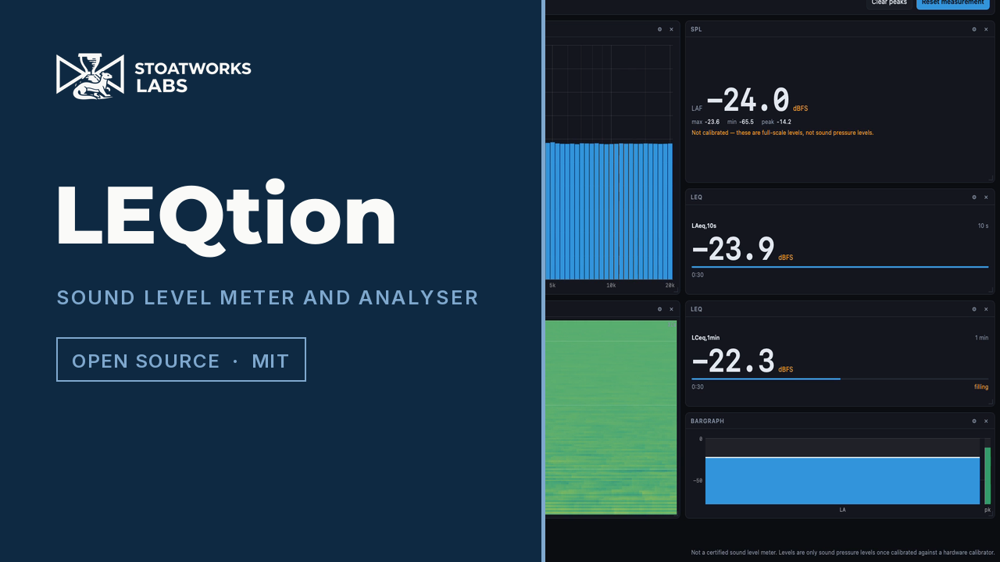
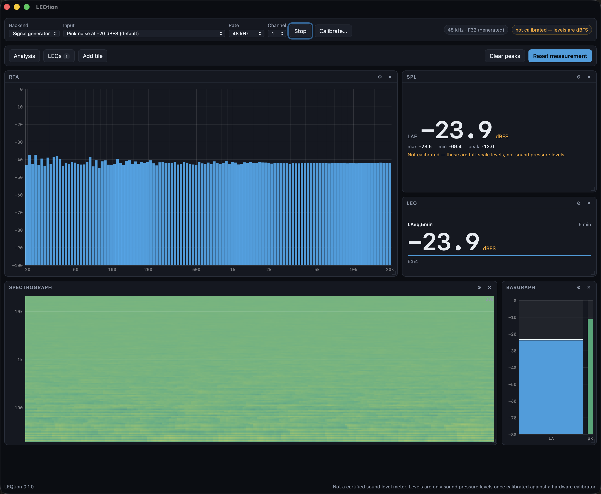

# LEQtion

> **AI-assisted project.** This codebase was created with [Claude Code](https://claude.com/claude-code)
> (Anthropic), directed and reviewed by a human author. The DSP is verified numerically and
> pinned as tests: the A and C weighting curves reproduce the IEC 61672-1 table to better than
> 0.06 dB at the exact midband frequencies, the weighting *filters* are held to a measured
> deviation budget per sample rate, a full-scale sine reads 0 dBFS through the band integrator,
> and LEQ is checked against signals whose answer is known in advance. The audio path has been
> run against real Core Audio hardware on macOS. It has **not** been checked against a reference
> sound level meter, no hardware calibrator has been connected to it, and the ASIO path compiles
> but has never carried audio. LEQtion is **not a certified sound level meter** and makes no
> conformance claim.

LEQtion is a desktop sound level meter and dual-channel analyser. It's got an RTA, a
spectrograph, a bargraph, time-weighted SPL, as many user-defined LEQs as you want, LEQ
periods as bars against a limit, level history charts, CSV logging, a vectorscope with phase
correlation, an EBU R 128 loudness meter, a signal generator and transfer function
measurement with phase and coherence, all on a grid of tiles you lay out yourself, each
meter reading whichever input you point it at.

[](https://www.youtube.com/watch?v=Qe8D6juRCU4)

*A 45-second tour. It's the actual app throughout, recorded on screen and driven over macOS
accessibility, and the whole time it's measuring its own signal generator, so there's no
hardware anywhere in the chain.*



*Measuring its own signal generator: pink noise at −20 dBFS through the `Signal
generator` backend, with no hardware in the chain. Pink noise is flat per octave, so a
fractional-octave RTA reading flat across the band is the check. A wrong window, a wrong
normalisation or a wrong band integration would show up as a tilt or a step instead. LAF and
LAeq,5min agree within 0.1 dB over a complete window, and every level says dBFS because
nothing here is calibrated.*

**Status: alpha.** The measurement core is well tested and the app runs, but it hasn't been
used in anger on a show yet.

## What it does

- **RTA**: fractional-octave spectrum from 1/1 down to 1/48, with selectable transform
  size, window, overlap, averaging and peak hold. A strip across the top names the
  tallest band and its level, refined to a fraction of a bin when it's a tone on top.
  A second input can be drawn over the bars as a line (the desk feed over the room
  mic, say), and if the two aren't in the same unit the line gets its own axis rather
  than borrowing the bars'.
- **Spectrograph**: the same bands over time, scrolling, on the same log axis as the RTA
  so the two line up when you stack them.
- **Bargraph**: a level meter with a held maximum, and a separate input-peak strip that
  stays in dBFS, because headroom is an electrical question.
- **SPL**: time-weighted level with Fast, Slow and Impulse, plus max, min and peak.
- **LEQ**: define as many as you like. Each has its own **window** (any length you type,
  or a preset from 1 second to an hour, or "since reset") and its own **weighting**
  (A, C or Z). They run in the engine, so an LEQ keeps integrating whether or not a tile
  is showing it. A window can also be **periodic**: consecutive fixed periods on the
  clock, one LEQ each, which is what a licence usually means by LAeq,15min.
- **LEQ periods**: those periods as bars, quarter hours starting at :00, :15, :30 and :45,
  with an optional limit line and the running total since reset. The period that was
  already under way when you pressed Start is hatched and marked short, because a
  six-minute LAeq drawn as a quarter-hour bar will get compared with a quarter-hour limit
  by somebody.
- **Level history**: any of those levels over time, drawn as a line (LEQ, or Fast, Slow
  and Impulse SPL, or peak) on whichever weighting you want. Each point covers a whole
  interval and the band around the line is the min and max *inside* it, so a transient
  between ticks makes it onto the chart instead of slipping through. Zooming out buckets
  the points in the engine and keeps the extremes, so the trace never flattens as you
  look further back. Up to six series share one chart, each in its own colour.
- **Data logging**: writes the measurement to a CSV, one row per interval, every series
  at once. The rows are the chart's own points rather than a second sampling on a
  different clock. Every row says whether it's calibrated and how many frames have been
  dropped, so a log that covers a gap in the audio admits it in the file.
- **Vectorscope**: a stereo pair as a goniometer, mono vertical, the diamond at full
  scale, with an afterglow. It zooms itself in 6 dB steps and prints the step, because
  a magnified trace that keeps quiet about it looks like a louder signal. Underneath,
  phase correlation from −1 to +1 with the lowest since reset held, and the balance.
- **Loudness**: ITU-R BS.1770 as EBU R 128 meters it. Momentary, short-term and
  integrated LUFS, loudness range, and true peak at 4× oversampling, checked against the
  EBU's own test cases (Tech 3341 and 3342). LUFS is relative to full scale and never
  sees a calibration.
- **Inputs**: every meter reads its own input. The measurement mic on 1 for the levels,
  the RTA and the transfer function; the desk's stereo feed on 3 and 4 for the
  vectorscope, the loudness and the RTA's comparison line. One table under **Inputs**
  in the toolbar, with a column showing what each meter is actually reading.
- **Calibration**: against a hardware acoustic calibrator, 94 or 114 dB at 1 kHz.
- **Tiles**: add, remove, drag and resize. The layout sticks.
- **Generator**: pink noise, white noise, sine and a repeating log sweep, out of a
  channel you choose, with optional band-limiting. Level is dBFS RMS and the expected
  *peak* is shown beside it, because pink noise at −6 dBFS RMS clips hard while looking
  like a nice conservative setting.
- **Transfer function**: magnitude, phase and coherence against a reference, which is
  either the generator's own output tapped internally or a hardware loopback on an input.
  Multi-time-window, so the bottom and top of the range are both usable.
- **Delay finding**: finds the arrival from the impulse response, sub-sample
  interpolated, and reports it in milliseconds, metres and samples with a confidence
  figure.
- **Signal generator as an input**: the same signals are also offered as a *backend*,
  feeding the analyser directly with no device in the chain. It's how you check the
  meter itself: pink noise reads flat on a fractional-octave display, so a wrong window,
  a wrong normalisation or a wrong band integration shows up as a tilt rather than as a
  plausible curve. It runs on a machine with no interface, no microphone and no
  microphone permission. Calibration is refused while it's open, since there's no
  capsule in the chain, and an offset taken from a synthetic sine would be a number made
  up out of nothing.
- **Backends**: Core Audio, WASAPI and ALSA out of the box; ASIO behind a build flag
  ([docs/asio.md](docs/asio.md)).

## The bits that matter

### LEQ is filtered in the time domain, not weighted after an FFT

LEQ is an integral of weighted pressure squared over time. If you get it by tilting an FFT
with a weighting curve, the answer depends on the window, the overlap and the transform
length, and none of those have anything to do with the sound. LEQtion filters the samples
through an IEC 61672 weighting filter and integrates those, so the answer depends only on the
signal.

A related trap the code guards against: **an LEQ isn't an average of a Fast-weighted
level.** That gets you close, and it's wrong in a way that grows with how peaky the signal
is. Averaging is done on mean squares throughout. A mean of decibels isn't a level, and
`leq.rs` has a test that fails if anyone "simplifies" it into one.

### The weighting filter, and what it actually achieves

The analogue A-weighting design has two more poles than zeros, and every s→z transform has
to do something with that surplus. Both textbook answers are badly wrong at the top of the
audio band:

| Design | A-weighting error at 19 kHz, 48 kHz sample rate |
|---|---|
| Bilinear — forces a double zero onto Nyquist | −13.6 dB |
| Plain matched-Z — invents no surplus zero at all | +7.2 dB |
| **What LEQtion does** | **under 1 dB** |

Sections carrying the numerator's zeros at the origin are bilinear, because bilinear maps
s=0 to z=1 and puts those zeros right where they belong. The pole-only sections are
matched-Z with a *single* shaping zero whose position is fitted, per sample rate, by a
golden-section search minimising the worst deviation from the analytic curve. It runs once
when a device opens.

Measured worst deviation over 20 Hz – 20 kHz:

| Sample rate | A | C |
|---|---|---|
| 44.1 kHz | 1.15 dB | 0.30 dB |
| 48 kHz | 0.99 dB | 0.21 dB |
| 96 kHz | 0.22 dB | 0.01 dB |

A minimax fit spreads its error around rather than keeping it in the top octave, so at
44.1 kHz A-weighting is about 1.1 dB out by 10 kHz. That's just the shape of it. In practice
it costs a lot less than that sounds: on a nasty 29-tone test signal with as much energy at
16 kHz as at 1 kHz, the resulting A-weighted level is 0.23 dB out. **Run at 96 kHz if you
care.** It costs nothing but CPU and makes the weighting effectively exact, which is why the
app shows the sample rate rather than hiding it.

### The transfer function shows you where not to believe it

`H = Sxy/Sxx`, the H1 estimator, from **complex-averaged** cross-spectra. There are three
details here, and getting any of them wrong gives you a plausible-looking curve that's wrong:
the cross-spectrum has to be averaged as a complex number, coherence is only defined across
averages (a single frame always reads a perfect 1), and the reference has to be
delay-compensated before any of it means anything.

Coherence is drawn, not hidden. Every point is faded in proportion to it, and the
magnitude trace **breaks** wherever coherence falls below the floor. A transfer function
without coherence looks just as confident where the measurement is solid as where it's
picking up the air conditioning, and people tune systems off the second kind.

### One FFT length cannot serve 20 Hz and 16 kHz

At 48 kHz a 16384-point transform gives 2.9 Hz bins: about right at 30 Hz, and absurdly
narrow at 10 kHz, where it buys nothing and costs stability. A short transform is the
reverse.

So several transforms run in parallel, each serving a couple of octaves and halving in
length as frequency rises, stitched onto one set of points at a fixed number per octave.
Each slice's length is chosen so its bin spacing is finer than the output point spacing at
the *bottom* of the range it serves, and a test checks that for every point.

### Uncalibrated levels are labelled dBFS, always

Until you calibrate, every level is a full-scale level and the app says so, on the SPL tile,
on the LEQ tile and in the device bar. An uncalibrated number dressed up as a sound pressure
level is the single most damaging thing a meter can do.

### Calibration is refused when it should be

A calibration is trusted silently for the rest of a measurement, so the run has to pass
four checks before it's accepted: a steady level (spread under 0.5 dB), the right frequency
(the tone has to be within 5% of what the calibrator claims), no clipping, and a tone well
clear of the noise floor. There's no override. Each refusal tells you what to do about it.
"Unstable" usually means the calibrator isn't seated on the capsule, so that's what the
message says, rather than just "unstable".

What it can't check: that the calibrator is itself in calibration, or that nobody changes
the preamp gain afterwards. One click of gain invalidates the offset completely and nothing
in software can detect it, which is why the calibration records the device it was taken on.

### A calibration belongs to one input

With every meter able to read its own input, the obvious mistake is a calibration taken
on the microphone turning up on the desk feed. So it doesn't. The calibration belongs to
the **levels** input, and only meters reading that same input are in dB SPL. The RTA on
input 3 reads dBFS and says so, even with the mic on input 1 calibrated to the decimal
place. Loudness never takes a calibration at all: LUFS is defined against full scale, and
a full-scale sine reads −3.01 LUFS against 0 dBFS on the level meters. Both are right.
They're answering different questions.

### Dropped audio is reported, loudly

If the analysis thread falls behind, the audio callback throws samples away rather than
blocking the driver. Time then goes missing, and every LEQ on screen is short by an unknown
amount. The device bar says so and tells you to restart the measurement, rather than carrying
on and hoping nobody notices.

## Command-line tools

Two diagnostics ship with it, for when a measurement looks wrong and the GUI is in the way.

Check that an input delivers audio at all:

```bash
cargo run -p leqtion-audio --example capture -- --list
```

```bash
cargo run -p leqtion-audio --example capture -- --seconds 3
```

If a run reports frames arriving at perfect digital silence, that's macOS denying
microphone access.

The whole measurement chain without the window, with the same engine and the same numbers:

```bash
cargo run --example meter -- --seconds 30 --offset 120
```

It takes the same routing as the app, inputs counted from 1:

```bash
cargo run --example meter -- --device "Pro Tools Audio Bridge 16" --levels 1 --compare 3 --stereo 3,4 --loudness 3,4
```

`capture --list` also shows output devices, which matters more than you'd think. If your
input device has no output side of the same name, the generator falls back to the default
output and the two run on **separate clocks**. The internal reference then drifts and the
delay has to be found again every few minutes. The app tells you when that happens. An
interface whose input and output are one device (any Dante card, any USB interface) doesn't
have this problem.

## Download

<!-- downloads:start -->

## Download

**[v0.1.3](https://github.com/stoatworks-labs/LEQtion/releases/tag/v0.1.3)** — prebuilt for macOS. Pick your platform:

<details>
<summary><b>macOS</b> — Apple Silicon, Intel</summary>

| Build | Download | Size |
| --- | --- | --- |
| Apple Silicon · .dmg disk image | [`leqtion-0.1.3-macos-aarch64.dmg`](https://github.com/stoatworks-labs/LEQtion/releases/download/v0.1.3/leqtion-0.1.3-macos-aarch64.dmg) | 3.8 MB |
| Intel · .dmg disk image | [`leqtion-0.1.3-macos-x86_64.dmg`](https://github.com/stoatworks-labs/LEQtion/releases/download/v0.1.3/leqtion-0.1.3-macos-x86_64.dmg) | 4.3 MB |
| Apple Silicon · .zip archive | [`leqtion-0.1.3-macos-aarch64.zip`](https://github.com/stoatworks-labs/LEQtion/releases/download/v0.1.3/leqtion-0.1.3-macos-aarch64.zip) | 3.8 MB |
| Intel · .zip archive | [`leqtion-0.1.3-macos-x86_64.zip`](https://github.com/stoatworks-labs/LEQtion/releases/download/v0.1.3/leqtion-0.1.3-macos-x86_64.zip) | 4.3 MB |

</details>

All builds, checksums and release notes: [github.com/stoatworks-labs/LEQtion/releases](https://github.com/stoatworks-labs/LEQtion/releases).

macOS builds are signed and notarised by Apple, so they open normally — no Gatekeeper warning and no quarantine step.

<!-- downloads:end -->

It's macOS only for now, on both architectures. That's down to the *builds* rather than the
code. Tauri can't cross-bundle, so a Windows installer has to be made on Windows and a Linux
AppImage on Linux, and the only Windows machine I've got is ARM64, which would make an
arm64-only installer rather than the x86_64 one a Windows user with an audio interface
actually needs.

The apps are **Developer ID-signed and notarised by Apple**, so they open normally, with no
Gatekeeper warning and no quarantine step.

## Build and run

```bash
npm install
```

```bash
npm run app
```

```bash
npm run app:build
```

Tests:

```bash
npm test && (cd src-tauri && cargo test --workspace)
```

## What still needs real hardware

The DSP is verified against synthetic signals and the audio path has run on real Core
Audio hardware on macOS, but nothing has been checked against a reference meter, a
calibrator or a loudspeaker. [`docs/field-test.md`](docs/field-test.md)
is the checklist for doing that, in the order the steps depend on each other: an electrical
loopback before anything acoustic, and calibration before either.

<!-- attributions:start -->
This project is built on other people's work — see [ATTRIBUTIONS.md](ATTRIBUTIONS.md).
<!-- attributions:end -->

## Licence

MIT.

---

All levels are computed, not certified. Calibrate against a hardware calibrator before
quoting a number, and check against a reference meter before anyone relies on one.
